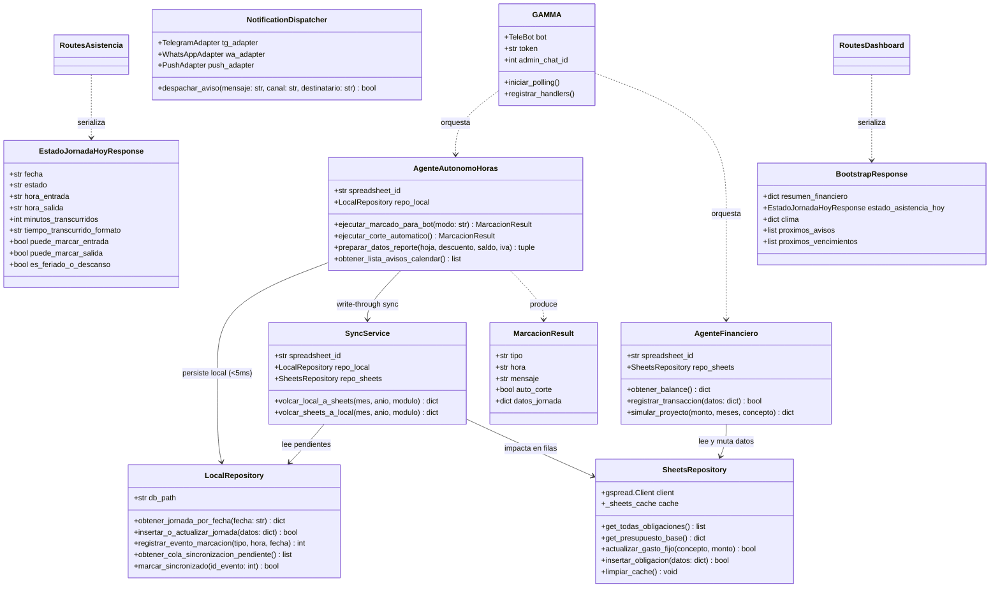
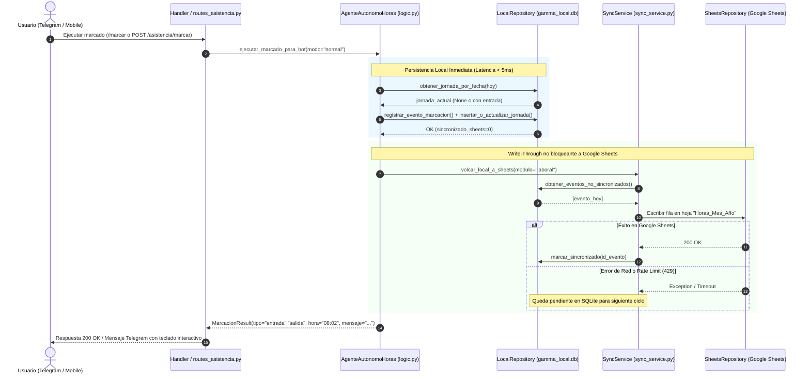
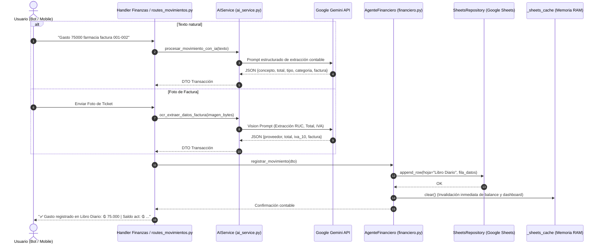
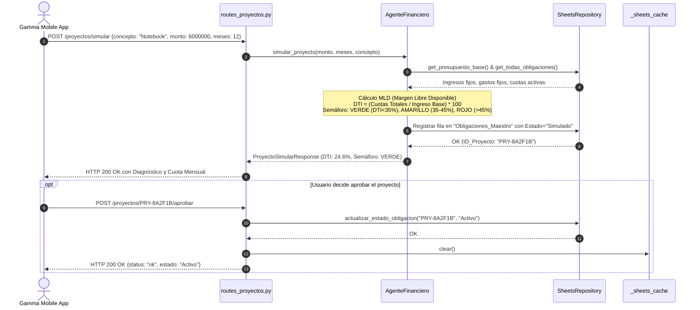
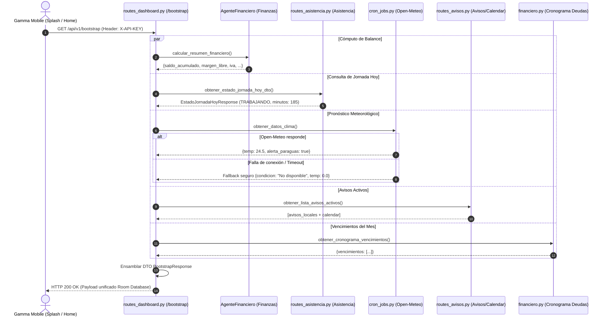
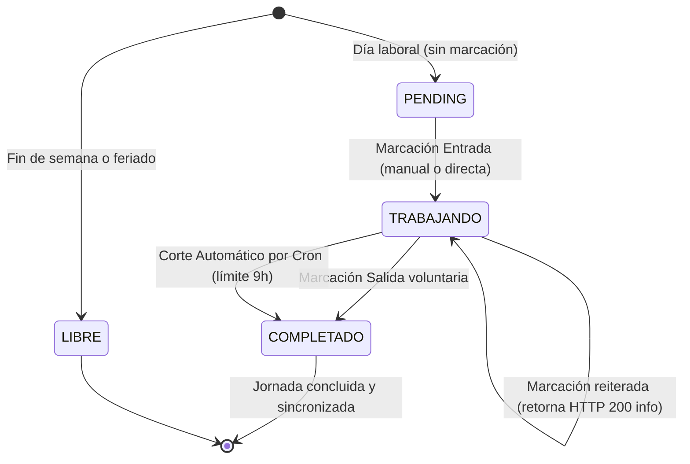

# Arquitectura del Core Backend: Conexión de Archivos, Módulos y Flujos de Comandos

Este documento describe la arquitectura modular, topología de archivos y flujos de ejecución del Core Backend de **Gamma Bot** (v2.0.0), integrando la interacción entre el Bot de Telegram, la API REST para Gamma Mobile, la sincronización Local-First y los servicios externos.

---

## 1. Topología Modular y Conexión de Archivos

El sistema está estructurado bajo una arquitectura por capas desacopladas (*Layered & Hexagonal Architecture*):

```mermaid
flowchart TD
    subgraph INGRESS["Capa de Entrada (Ingress / Presentation)"]
        WSGI["flask_app.py<br/>(WSGI / Endpoints / Webhooks)"]
        TG_BOT["com/bot.py<br/>(GAMMA Class / TeleBot)"]
        API_V1["api/v1/__init__.py<br/>(Blueprint Router Central)"]
        SEC["api/security.py<br/>(@require_api_key, Limiter)"]
        SCHEMAS["api/schemas.py<br/>(DTOs Pydantic v2)"]
    end

    subgraph ROUTES["Blueprints REST API (api/v1/)"]
        R_DASH["routes_dashboard.py<br/>(/summary, /bootstrap)"]
        R_ASIS["routes_asistencia.py<br/>(/marcar, /estado-hoy, /sync)"]
        R_PRE["routes_presupuesto.py<br/>(/fijos, /salario-base, /techos)"]
        R_PROY["routes_proyectos.py<br/>(/simular, /{id}/aprobar)"]
        R_OBL["routes_obligaciones.py<br/>(/vencimientos, /foco, /abonar)"]
        R_MOV["routes_movimientos.py<br/>(/movimientos, /ocr, /parse)"]
        R_REP["routes_reportes.py<br/>(/financiero/excel, /pdf)"]
        R_AVI["routes_avisos.py<br/>(/avisos, /ia/interpretar)"]
        R_CLI["routes_clima.py<br/>(/clima)"]
        R_CIE["routes_cierres.py<br/>(/cierres/ejecutar)"]
        R_DIS["routes_dispositivos.py<br/>(/dispositivos/registrar, /notificar)"]
    end

    subgraph HANDLERS["Controladores Telegram (com/handlers/)"]
        H_BASE["base.py<br/>(/start, /help, /menu)"]
        H_ASIS["asistencia.py<br/>(/marcar, /corte, /asistencia)"]
        H_FIN["finanzas.py<br/>(Registro gastos/ingresos, fotos)"]
        H_DEU["deudas.py<br/>(/deudas, /vencimientos, /foco)"]
        H_AVI["avisos.py<br/>(/aviso, /recordatorio)"]
        H_SOP["soporte.py<br/>(/ticket, consultas técnicas)"]
    end

    subgraph LOGIC["Lógica de Negocio y Dominio (logic/)"]
        L_HORAS["logic.py<br/>(AgenteAutonomoHoras)"]
        L_FIN["financiero.py<br/>(AgenteFinanciero, MLD, DTI)"]
        L_AI["ai_service.py<br/>(AIService, Gemini NLP/OCR)"]
        L_CRON["cron_jobs.py<br/>(Clima, Resumen, Cortes)"]
        L_PDF["pdf_service.py<br/>(Generación PDF ReportLab)"]
    end

    subgraph SERVICES["Servicios Transversales (services/)"]
        S_SYNC["sync_service.py<br/>(SyncService Local <-> Sheets)"]
        S_NOTIF["notification_dispatcher.py<br/>(Despachador Multicanal)"]
        S_CASH["cashflow_service.py<br/>(Proyecciones de Caja)"]
        S_EXCEL["excel_service.py<br/>(openpyxl Generator)"]
    end

    subgraph ADAPTERS["Adaptadores de Notificación (adapters/notifications/)"]
        A_TG["telegram_adapter.py<br/>(Telegram API)"]
        A_WA["whatsapp_adapter.py<br/>(Evolution API)"]
        A_PUSH["push_adapter.py<br/>(Firebase Cloud Messaging)"]
    end

    subgraph REPOSITORIES["Capa de Persistencia y Datos (repositories/)"]
        REPO_LOC["local_repository.py<br/>(LocalRepository SQLite: gamma_local.db)"]
        REPO_SHT["sheets_repository.py<br/>(SheetsRepository + Cache TTL + gspread)"]
    end

    subgraph STORAGE["Almacenamiento Físico"]
        DB_SQLITE[("gamma_local.db<br/>(SQLite Local)")]
        G_SHEETS[("Google Sheets API<br/>(Workbooks Drive)")]
    end

    %% Relaciones de Ingress
    WSGI --> TG_BOT
    WSGI --> API_V1
    API_V1 --> SEC
    API_V1 --> ROUTES
    ROUTES --> SCHEMAS

    %% Relaciones de Handlers
    TG_BOT --> HANDLERS

    %% Rutas y Handlers a Lógica
    R_ASIS --> L_HORAS
    H_ASIS --> L_HORAS
    R_DASH --> L_FIN
    R_PRE --> REPO_SHT
    R_PROY --> L_FIN
    R_OBL --> L_FIN
    H_FIN --> L_FIN
    H_FIN --> L_AI
    H_DEU --> L_FIN
    R_MOV --> L_AI
    R_MOV --> L_FIN
    R_REP --> S_EXCEL
    R_REP --> L_PDF
    R_AVI --> L_HORAS
    R_CLI --> L_CRON

    %% Lógica a Servicios y Repositorios
    L_HORAS --> REPO_LOC
    L_HORAS --> S_SYNC
    L_FIN --> REPO_SHT
    L_CRON --> S_NOTIF
    S_SYNC --> REPO_LOC
    S_SYNC --> REPO_SHT
    S_NOTIF --> A_TG
    S_NOTIF --> A_WA
    S_NOTIF --> A_PUSH

    %% Repositorios a Storage
    REPO_LOC --> DB_SQLITE
    REPO_SHT --> G_SHEETS
```

---

## 2. Diagrama de Clases del Core (`classDiagram`)

Representación de las principales clases del dominio, servicios y persistencia:

---

## 3. Flujos de Comandos y Procesos (Sequence Diagrams)

### 3.1 Flujo de Marcación Laboral (Local-First + Write-Through Reactivo)

Muestra cómo una marcación (desde Telegram `/marcar` o desde Mobile `POST /asistencia/marcar`) garantiza persistencia inmediata sin latencia y actualización a Google Sheets:

---

### 3.2 Flujo de Registro Inteligente de Transacciones (NLP / OCR)

Muestra el pipeline cuando el usuario envía un texto `"Almuerzo 45000 efectivo"` o una foto de factura:

---

### 3.3 Flujo de Simulación y Aprobación de Proyectos de Inversión

Muestra la evaluación paramétrica de viabilidad de crédito y su pase a deuda activa:

---

### 3.4 Flujo de Hidratación Atómica de la App Móvil (`GET /bootstrap`)

Muestra la agregación paralela y resiliente ante fallos de subsistemas externos:

---

## 4. Máquina de Estados del Reloj Laboral

