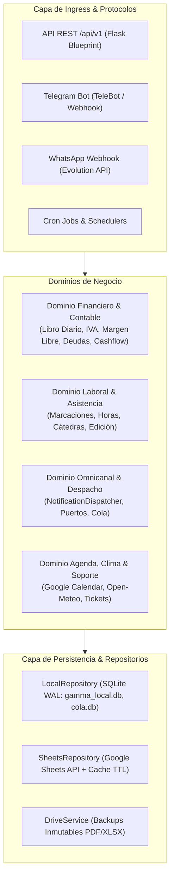

# SYSTEM MAP — Gamma Bot & Gamma Mobile Backend

> **Inventario Canónico de Verdad del Sistema e Invariantes Operativos**  
> **Versión del Sistema:** 2.1.4 | **Estado CI/CD:** ✅ 520+ tests pasando  
> **Última Actualización:** 2026-11-11  

---

## 1. Topología Modular y Dominios Funcionales

El backend opera bajo arquitectura hexagonal desacoplada (*Ports & Adapters*) con persistencia dual (Local-First SQLite con WAL + Réplica determinista en Google Sheets):



---

## 2. Catálogo de Dominios y Capacidades Activas

### 2.1 Dominio Financiero & Contable

| Módulo / Capacidad | Descripción Operativa | Interfaces Habilitadas | Archivos Ancla |
|---|---|---|---|
| **Libro Diario Contable** | Registro atómico de ingresos y egresos con 16 columnas tributarias, cálculo automático de IVA (10%, 5%, Exenta) y determinación de posición fiscal (Débito vs Crédito Fiscal). | REST: `/movimientos`<br/>Telegram: `/gasto`, `/ingreso`<br/>WhatsApp: Mensajes texto/voz | `src/logic/financiero.py`<br/>`src/repositories/sheets_repository.py`<br/>`src/api/v1/routes_movimientos.py` |
| **Parser NLP Financiero** | Motor regex determinista de alto rendimiento (<5ms) para extracción de montos (`k`, `mil`, `m`), monedas (Gs., USD), comercios paraguayos reconocidos y categorías. | REST: `/movimientos/parse`<br/>WhatsApp webhook<br/>Telegram mensajes libres | `src/utils/nlp_parser.py`<br/>`tests/test_nlp_parser.py` |
| **OCR Facturas y Comprobantes** | Extracción multimodal con Gemini 2.5 de datos fiscales (RUC, Timbrado, Total, IVA) a partir de imágenes enviadas por el usuario. | REST: `/movimientos/ocr`<br/>Telegram: Envío de fotos | `src/logic/ai_service.py`<br/>`src/com/handlers/finanzas.py` |
| **Margen Libre Disponible (MLD)** | Diagnóstico estructural mensual desacoplado de gastos operativos cotidianos: $MLD = SalarioBase - GastosFijos - \sum CuotasFijasActivas$. | REST: `/dashboard/summary`<br/>Telegram: `/balance` | `src/logic/financiero.py`<br/>`src/api/v1/routes_dashboard.py` |
| **Presupuesto y Gastos Fijos** | Administración de conceptos estructurales (alquiler, internet, servicios) y techos presupuestarios con alertas preventivas al 80% y 100% y cooldown de 24h. | REST: `/presupuesto/*`<br/>Telegram: `/fijos`, `/fijo_set` | `src/services/presupuesto_service.py`<br/>`src/api/v1/routes_presupuesto.py` |
| **Obligaciones y Desendeudamiento** | Catálogo de pasivos en `Obligaciones_Maestro` (17 columnas, campos `Cuotas` y `Event_ID` legados/deprecados según [guia-saneamiento-obligaciones.md](file:///e:/PG/vcp-s/Gamma_bot/docs/specs/paridad-presupuesto-obligaciones-mobile/guia-saneamiento-obligaciones.md)), soporte de amortización con asiento unificado en Libro Diario, pausa reactiva (`Es_Gasto_Fijo=0`) y estrategias Avalancha vs Bola de Nieve. | REST: `/obligaciones/*`<br/>Telegram: `/deudas`, `/nueva_deuda`, `/abonar`, `/foco` | `src/logic/financiero.py`<br/>`src/api/v1/routes_obligaciones.py`<br/>`src/com/handlers/deudas.py` |
| **Flujo de Caja a 30 Días** | Motor predictivo diario (`CashFlowProjector`) que modela saldo inicial, ingresos programados, vencimientos de deudas y consumo variable, alertando sobre días críticos. | REST: `/proyecciones/flujo-caja` | `src/services/cashflow_service.py`<br/>`src/api/v1/routes_proyecciones.py` |
| **Simulador de Proyectos** | Evaluación What-If de impacto en el Margen Libre y DTI (Debt-to-Income) al asumir nuevos créditos, con aprobación automática y pase a deuda activa. | REST: `/proyectos/*`<br/>Telegram: `/simular`, `/aprobar_proyecto` | `src/logic/financiero.py`<br/>`src/api/v1/routes_proyectos.py` |
| **Cierres Mensuales y Reportes** | Validación de consistencia previa, asiento consolidado en `Cierres_Historicos`, reseteo ordenado de Libro Diario, backup inmutable en Drive y generación de PDF/Excel oficial. | REST: `/cierres/*`, `/reportes/*`<br/>Telegram: `/cierre_mensual` | `src/logic/financiero.py`<br/>`src/services/excel_service.py`<br/>`src/logic/pdf_service.py` |

### 2.2 Dominio Laboral & Asistencia

| Módulo / Capacidad | Descripción Operativa | Interfaces Habilitadas | Archivos Ancla |
|---|---|---|---|
| **Reloj Marcador Laboral** | Marcaciones de Entrada, Pausa Almuerzo, Vuelta Almuerzo y Salida con persistencia local (<5ms) y corte automático a las 9 horas. | REST: `/asistencia/marcar`, `/asistencia/estado-hoy`<br/>Telegram: `/marcar`, inline keyboards | `src/logic/logic.py`<br/>`src/services/asistencia_service.py`<br/>`src/repositories/local_repository.py` |
| **Modo Edición y Rectificación** | Rectificación de jornadas erróneas o reabertura de salidas accidentales con desafío de autenticación seguro y eliminación de clave en chat. | REST: `PUT /asistencia/jornadas/<fecha>`<br/>Telegram: `/editar`, `/editar_asistencia` | `src/services/asistencia_service.py`<br/>`src/com/handlers/asistencia.py`<br/>`src/api/v1/routes_asistencia.py` |
| **Cátedras Universitarias** | Registro y control de horas teóricas y prácticas para docencia en planilla aislada (`SPREADSHEET_MATERIAS_ID`). | REST: `/asistencia/materia`, `/asistencia/materias` | `src/repositories/local_repository.py`<br/>`src/api/v1/routes_asistencia.py` |
| **Sincronización Determinista** | Escaneo secuencial en filas 2 a 40 de Google Sheets respetando la fórmula oficial en columna G mediante `USER_ENTERED`. | REST: `/asistencia/sync`<br/>Auto-sync en deploy y background | `src/services/sync_service.py`<br/>`tests/test_sync_service.py` |

### 2.3 Dominio Omnicanal & Despacho

| Módulo / Capacidad | Descripción Operativa | Interfaces Habilitadas | Archivos Ancla |
|---|---|---|---|
| **Notification Dispatcher** | Despachador agnóstico con interfaz canónica `INotificationPort` que enruta a Telegram, WhatsApp o Push según disponibilidad y preferencias. | Interno / Cross-domain | `src/services/notification_dispatcher.py`<br/>`src/ports/notification_port.py` |
| **Cola Asíncrona (WAL)** | Buffer persistente en SQLite (`cola.db`) para procesamiento de webhooks y desacoplamiento de tiempos de respuesta hacia clientes de chat. | Interno / Webhook WhatsApp | `src/app_queue/` |
| **Gestión de Dispositivos Push** | Registro idempotente de tokens móviles FCM para envío de alertas a Gamma Mobile Android. | REST: `/dispositivos/*` | `src/adapters/notifications/push_adapter.py`<br/>`src/api/v1/routes_dispositivos.py` |

---

## 3. Invariantes Críticos No Negociables (System Invariants)

| ID | Invariante | Regla Operativa Estricta | Archivo Custodio | Suite de Pruebas |
|---|---|---|---|---|
| **INV-F1** | **Aislamiento de Hojas Contables vs Laborales** | Prohibido usar `LIBRO_CONTABLE_ID` como fallback en módulos de asistencia laboral o universitaria. Cada dominio tiene su propio Spreadsheet ID independiente para evitar contaminación de planillas. | `src/services/sync_service.py`<br/>`src/api/v1/routes_asistencia.py` | `tests/test_sync_service.py`<br/>`tests/test_mobile_api.py` |
| **INV-F2** | **Invarianza del Margen Libre (MLD)** | Los gastos operativos diarios (almuerzos, combustible, farmacia) **nunca** descuentan del Margen Libre Disponible. El MLD solo refleja ingresos estructurales menos costos fijos y deudas fijas activas. Los gastos diarios solo descuentan del `saldo_acumulado` en caja. | `src/logic/financiero.py`<br/>`src/api/v1/routes_dashboard.py` | `tests/test_margen_libre_dominio.py`<br/>`tests/test_balance_dashboard.py` |
| **INV-F3** | **Asiento Unificado en Abono de Deudas** | Todo abono o amortización a una obligación genera automáticamente y en el mismo instante un asiento contable de egreso en el `Libro_Diario` con el identificador de la obligación, garantizando conciliación total. | `src/logic/financiero.py:abonar_obligacion` | `tests/test_financiero.py`<br/>`tests/test_handlers_deudas.py` |
| **INV-F4** | **Consistencia Numérica Pre-Cierre** | Es mandatorio validar la igualdad matemática entre saldo inicial, suma de ingresos y egresos antes de ejecutar el cierre mensual. Si existe discrepancia, el cierre se aborta para proteger los registros históricos. | `src/logic/financiero.py:validar_consistencia_movimientos_mes` | `tests/test_financiero.py`<br/>`tests/test_cierres_api.py` |
| **INV-F5** | **Cooldown Anti-Spam Presupuestario** | Toda alerta preventiva de desvío presupuestario (80% o 100%) debe respetar un cooldown de 24 horas por categoría, evitando fatiga informativa al usuario ante múltiples compras consecutivas. | `src/services/presupuesto_service.py` | `tests/test_presupuesto_alertas_service.py` |
| **INV-F6** | **Seguridad de Credenciales en Canales Públicos** | Todo mensaje recibido con credenciales sensibles o API Keys (como en el comando `/editar`) debe ser eliminado inmediatamente de Telegram mediante `bot.delete_message` antes de responder. | `src/com/handlers/asistencia.py` | `tests/test_modo_edicion_asistencia.py` |
| **INV-F7** | **Preservación de Fórmulas en Sheets Laborales** | Las actualizaciones de asistencia en Google Sheets deben realizarse sobre celdas C:F con `value_input_option="USER_ENTERED"`, preservando intacta la fórmula oficial de cálculo de horas en columna G. | `src/services/sync_service.py` | `tests/test_sync_service.py` |
| **INV-F8** | **Inmutabilidad Criptográfica de Releases** | Queda prohibido el uso de fallbacks silenciosos a claves efímeras de firma (`debug.keystore`) en pipelines de release. Si los secretos oficiales no están presentes, el job debe abortar con error explícito. | `.github/workflows/` | Verificación por `apksigner` |
| **INV-A4** | **Garantía de Hoja Única A4 en Liquidación Laboral** | Todo reporte mensual de liquidación de horas (hasta 31 días corridos más cuadro de facturación con IVA) debe compilar estrictamente en una sola página física A4 (ocupación ≤95%, margen libre de seguridad ≥2 cm). | `src/logic/pdf_service.py` | `tests/test_pdf_a4_fit.py` |

---

## 4. Archivos Ancla y Cobertura de Verificación

```text
Suite Total de Pruebas: 506 tests pasando (100% verde)
Ejecución: uv run pytest
Herramientas de Calidad: black (formato), flake8 (linter), mypy (tipado estático), bandit (seguridad AST)
```

| Componente | Archivo de Código | Archivo de Test Asociado |
|---|---|---|
| Lógica Financiera & Deudas | `src/logic/financiero.py` | `tests/test_financiero.py`, `tests/test_margen_libre_dominio.py` |
| Repositorio Google Sheets | `src/repositories/sheets_repository.py` | `tests/test_sheets_repository.py` |
| Repositorio Local SQLite | `src/repositories/local_repository.py` | `tests/test_local_repository.py` |
| Proyecciones de Flujo de Caja | `src/services/cashflow_service.py` | `tests/test_cashflow_service.py`, `tests/test_proyecciones_routes.py` |
| Alertas Presupuestarias | `src/services/presupuesto_service.py` | `tests/test_presupuesto_alertas_service.py`, `tests/test_presupuestos_variables.py` |
| Parser NLP de Transacciones | `src/utils/nlp_parser.py` | `tests/test_nlp_parser.py`, `tests/test_nlp_routes.py` |
| Sincronización Determinista | `src/services/sync_service.py` | `tests/test_sync_service.py` |
| Cierres Contables & Laborales | `src/api/v1/routes_cierres.py` | `tests/test_cierres_api.py` |
| Modo Edición Asistencia | `src/services/asistencia_service.py` | `tests/test_modo_edicion_asistencia.py`, `tests/test_rectificar_jornada.py` |
| Auto-Descubrimiento & Capacidades | `src/api/v1/routes_capacidades.py` | `tests/test_mobile_api.py`, `tests/test_api_schemas_v2.py` |
| Liquidación & Reportes A4 | `src/logic/pdf_service.py` | `tests/test_pdf_a4_fit.py`, `tests/test_services.py` |
| API REST Mobile (Gamma Mobile) | `src/api/v1/*` | `tests/test_mobile_api.py`, `tests/test_api_schemas_v2.py` |
