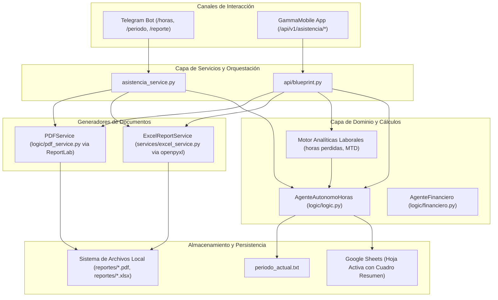

# Plan de Arquitectura y Diseño Técnico (Plan) — Afinamiento del Módulo Laboral-Financiero

- **Fecha:** 27 de Octubre de 2026
- **Módulo:** Asistencia Laboral, Facturación y Reportes Financieros (`Gamma_bot`)
- **Fase SDD:** 0 (Especificación y Arquitectura)
- **Estado:** Listo para revisión de planificación (Planning Gate)

---

## 1. Arquitectura Modular y Flujo de Componentes



---

## 2. Contratos de Datos y Esquemas (DTOs / Pydantic)

### 2.1 Esquema de Analíticas de Asistencia (`AnaliticasHorasResponse`)
```python
class AnaliticasHorasResponse(BaseModel):
    periodo: str
    monto_por_hora: int
    dias_trabajados: int
    total_horas_decimal: float
    total_horas_formato: str  # ej. "107h 18m"
    salario_acumulado_gs: int
    horas_perdidas_decimal: float
    horas_extras_decimal: float
    balance_neto_decimal: float
    horas_perdidas_formato: str
    horas_extras_formato: str
    balance_neto_formato: str
    promedio_horas_por_dia: float
```

### 2.2 Esquema de Consulta de Períodos (`PeriodosResponse`)
```python
class PeriodosResponse(BaseModel):
    periodo_laboral: str
    periodo_contable: str
    sincronizados: bool
```

### 2.3 Esquema de Resumen de Liquidación de Horas (`CuadroResumenHoras`)
```python
class CuadroResumenHoras(BaseModel):
    mes_horas: float  # Total horas del mes (ej. 107.3)
    hora_tarifa: int  # Monto por hora (ej. 14634)
    por_horas: int  # mes_horas * hora_tarifa (ej. 1569984)
    iva_10: int  # 10% de por_horas (ej. 156998)
    incluido: int  # por_horas + iva_10 (ej. 1726983)
    tipo_ajuste: Optional[str] = (
        None  # "ajuste" (suma), "descuento" (resta) o None
    )
    monto_ajuste: int = 0  # Monto absoluto del ajuste/descuento
    factura_total: int  # Total final a facturar
```

---

## 3. Fórmulas Matemáticas y Reglas de Negocio

### 3.1 Liquidación Contable de Horas
1. **Total Horas del Mes ($H$):**
   $$H = \sum_{i=1}^{N} h_i \quad \text{donde } h_i \text{ es la jornada en horas decimales del día } i$$
2. **Monto por Horas ($M_{\text{horas}}$):**
   $$M_{\text{horas}} = \text{round}(H \times T_{\text{hora}})$$
3. **IVA 10% ($IVA$):**
   $$IVA = \text{round}(M_{\text{horas}} \times 0.10)$$
4. **Subtotal INCLUIDO ($S_{\text{inc}}$):**
   $$S_{\text{inc}} = M_{\text{horas}} + IVA$$
5. **Total Factura ($F$):**
   $$F = \begin{cases} 
   S_{\text{inc}} + A & \text{si tipo\_ajuste = 'ajuste' (extraordinario adeudado)} \\
   S_{\text{inc}} - D & \text{si tipo\_ajuste = 'descuento' (deducción/anticipo)} \\
   S_{\text{inc}} & \text{si no hay ajuste/descuento}
   \end{cases}$$

### 3.2 Analíticas de Cumplimiento Laboral (Jornada Estándar de 8 Horas)
Para cada día $d$ con marcaciones laborales registradas ($h_d > 0$):
- **Déficit del día ($p_d$):** $\max(0, 8.0 - h_d)$
- **Superávit del día ($e_d$):** $\max(0, h_d - 8.0)$
- **Total Horas Perdidas:** $P = \sum p_d$
- **Total Horas Extras:** $E = \sum e_d$
- **Balance Neto:** $B = H - (N_{\text{días trabajados}} \times 8.0)$

---

## 4. Diseño del Generador de Planilla Excel (`ExcelReportService`)

Se implementará el servicio `ExcelReportService` en `src/services/excel_service.py` utilizando `openpyxl`:
1. **Título:** Fila 1 fusionada A1:G1, fuente Calibri Negrita tamaño 14, centrado, fondo gris claro (`#D9D9D9` o `#EFEFEF`):
   `REGISTRO DE HORAS DEL MES DE [MES] [AÑO] - KEVIN PERALTA`
2. **Encabezados:** Fila 2 A2:G2 con fondo gris oscuro (`#B0B0B0`), texto en negrita:
   `Día` | `Fecha` | `Hora entrada` | `Salgo almuerzo` | `Vuelta almuerzo` | `Hora salida` | `Horas`
3. **Cuerpo de Datos:** Filas 3 en adelante con bordes delgados, alineación centrada para fecha y horas, y formato numérico `0.00` para la columna de horas (G).
4. **Cuadro Resumen Inferior:**
   Ubicado dos filas debajo del último registro, ocupando columnas A y B:
   - Fila R1: `Resumen` | `Cantidades` (fondo gris encabezado, negrita, bordes).
   - Fila R2: `mes` | `=SUMA(G3:G[K])` (o valor decimal formateado `0.0`).
   - Fila R3: `hora` | `14634` (formato moneda `$#,##0`).
   - Fila R4: `por Horas` | `=B[R2]*B[R3]` (formato moneda `$#,##0`).
   - Fila R5: `IVA 10%` | `=REDONDEAR(B[R4]*0.1, 0)` (formato moneda `$#,##0`).
   - Fila R6: `INCLUIDO` | `=B[R4]+B[R5]` (formato moneda `$#,##0`).
   - Fila Opcional (si aplica): `FACTURAD` / `Descuento` | Monto (formato moneda).
   - Fila Final: `FACTURA` | `=B[R6] +/- Ajuste` (fondo gris/negrita destacado, formato moneda `$#,##0`).

---

## 5. Diseño de Comandos y Endpoints

### 5.1 Telegram Bot
- `/horas`: Consulta rápida en texto del estado MTD:
  ```text
  ⏱️ Resumen Laboral — Octubre 2026
  ━━━━━━━━━━━━━━━━━━━━━━
  📅 Días trabajados: 14 días
  ⏰ Horas acumuladas: 107.3h (107h 18m)
  💰 Salario devengado: $1,569,984
  📉 Horas perdidas (<8h): 6.4h
  📈 Horas extras (>8h): 2.1h
  ⚖️ Balance neto: -4.3h
  ```
- `/periodo`: Muestra el período activo laboral y el contable:
  ```text
  🗓️ Estado de Períodos — Gamma Bot
  ━━━━━━━━━━━━━━━━━━━━━━
  🛠️ Período Laboral Activo: Octubre 2026
  📚 Período Contable Activo: Octubre 2026
  ✅ Subsistemas sincronizados
  ```
- `/reporte`: Ofrece opciones para enviar PDF, Excel `.xlsx` o ambos al chat.

### 5.2 Endpoints REST en `api/blueprint.py`
- `GET /api/v1/asistencia/periodos`: Retorna `PeriodosResponse`.
- `GET /api/v1/asistencia/analiticas`: Retorna `AnaliticasHorasResponse`.
- `GET /api/v1/asistencia/reporte/excel`: Genera y descarga binariamente el `.xlsx`.
- `GET /api/v1/asistencia/reporte/pdf`: Genera y descarga binariamente el `.pdf`.
