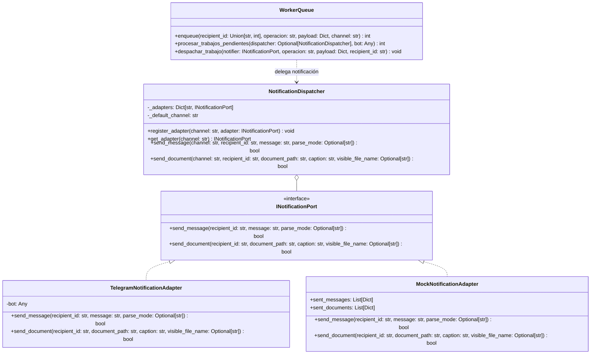

# PLAN DE ARQUITECTURA TÉCNICA: DESPACHADOR MULTI-CANAL Y COLA AGNÓSTICA (V2.0.0 FASE 2)

**Feature:** `despachador-multicanal-v2-fase2`  
**Fecha:** 2 de Noviembre de 2026  
**Fase:** Fase 0 — Especificación y Arquitectura  

---

## 1. Arquitectura Hexagonal (Ports & Adapters)



---

## 2. Contratos e Interfaces de Dominio

### 2.1. Puerto Abstracto: `src/ports/notification_port.py`
```python
from abc import ABC, abstractmethod
from typing import Optional


class INotificationPort(ABC):
    """Puerto canónico para el envío agnóstico de notificaciones a través de diferentes canales."""

    @abstractmethod
    def send_message(
        self,
        recipient_id: str,
        message: str,
        parse_mode: Optional[str] = None,
    ) -> bool:
        """Envía un mensaje de texto plano o con formato enriquecido al destinatario."""
        pass

    @abstractmethod
    def send_document(
        self,
        recipient_id: str,
        document_path: str,
        caption: str = "",
        visible_file_name: Optional[str] = None,
    ) -> bool:
        """Envía un archivo o documento (ej. PDF) al destinatario."""
        pass
```

### 2.2. Adaptador de Telegram: `src/adapters/notifications/telegram_adapter.py`
- Encapsula una instancia de `bot` (típicamente `telebot.TeleBot`).
- Convierte `recipient_id` a entero en caso de ser necesario para la API de Telegram, manejando excepciones controladas (`telebot.apihelper.ApiException`).
- Abre el archivo local en modo binario para `send_document` y asegura el cierre del descriptor.

### 2.3. Despachador de Canales: `src/services/notification_dispatcher.py`
- Mantiene un diccionario de adaptadores `{channel_name: INotificationPort}`.
- Permite configurar un canal por defecto (`default_channel="telegram"`).
- Si se solicita un canal no registrado, lanza `ValueError` informativo o recurre a un *fallback adapter* según configuración.

---

## 3. Esquema de Base de Datos y Estrategia de Migración (`cola.db`)

### 3.1. Esquema Objetivo
```sql
CREATE TABLE IF NOT EXISTS queue (
    id INTEGER PRIMARY KEY AUTOINCREMENT,
    recipient_id TEXT,
    channel TEXT NOT NULL DEFAULT 'telegram',
    chat_id INTEGER, -- Mantenido por retrocompatibilidad con queries directas
    operacion TEXT NOT NULL,
    payload_json TEXT NOT NULL,
    estado TEXT NOT NULL DEFAULT 'pendiente',
    reintentos INTEGER NOT NULL DEFAULT 0,
    next_retry INTEGER NOT NULL DEFAULT 0,
    creado_at INTEGER NOT NULL
);
```

### 3.2. Procedimiento de Migración en `init_db()`
Para bases de datos existentes que ya cuenten con la tabla `queue`:
1. Inspeccionar columnas mediante `PRAGMA table_info(queue);`.
2. Si `recipient_id` no existe:
   ```sql
   ALTER TABLE queue ADD COLUMN recipient_id TEXT;
   UPDATE queue SET recipient_id = CAST(chat_id AS TEXT) WHERE recipient_id IS NULL;
   ```
3. Si `channel` no existe:
   ```sql
   ALTER TABLE queue ADD COLUMN channel TEXT NOT NULL DEFAULT 'telegram';
   ```
4. Crear índice opcional para consultas eficientes:
   ```sql
   CREATE INDEX IF NOT EXISTS idx_queue_estado_retry ON queue (estado, next_retry, creado_at);
   ```

---

## 4. Evolución de la API del Worker (`src/app_queue/worker.py`)

### 4.1. Firma de `enqueue()`
```python
def enqueue(
    recipient_id: Union[str, int],
    operacion: str,
    payload: Dict[str, Any],
    channel: str = "telegram",
    sync_fallback: bool = False,
    notifier: Optional[INotificationPort] = None,
    bot: Any = None,
) -> int:
```
- Parámetros posicionales históricos:
  `enqueue(chat_id, operacion, payload)` continúa operando exactamente igual, mapeando el primer argumento a `recipient_id` y asignando `channel="telegram"`.
- Inserción en DB:
  Guarda simultáneamente `recipient_id = str(recipient_id)`, `channel = channel` y `chat_id = int(recipient_id)` (si es numérico, o 0 si es alfanumérico) para máxima paridad.

### 4.2. Firma de `procesar_trabajos_pendientes()`
```python
def procesar_trabajos_pendientes(
    bot: Any = None,
    dispatcher: Optional[NotificationDispatcher] = None,
) -> int:
```
- Si se pasa `bot` (modo legado de `run_bot.py` o `flask_app.py`), se envuelve automáticamente en un `TelegramNotificationAdapter(bot)` y se registra en un `NotificationDispatcher` temporal para el ciclo de ejecución.
- Si se pasa `dispatcher`, se utiliza directamente para resolver el adaptador de cada trabajo según la columna `channel`.

### 4.3. Firma de `despachar_trabajo()`
```python
def despachar_trabajo(
    notifier: INotificationPort,
    operacion: str,
    payload: Dict[str, Any],
    recipient_id: str,
) -> None:
```
- Eliminación total de llamadas a `bot.send_message` o `bot.send_document`.
- Utiliza exclusivamente `notifier.send_message(...)` y `notifier.send_document(...)`.
- Sobrecarga retrocompatible: si un llamador legado envía `bot` como primer argumento en lugar de `INotificationPort`, se detecta y envuelve de forma automática.

---

## 5. Estrategia de Testing y Verificación

1. **Tests Unitarios de Puerto y Adaptadores (`tests/test_notification_ports.py`):**
   - Verificación de contratos con `MockNotificationAdapter`.
   - Comportamiento de `TelegramNotificationAdapter` ante éxitos y excepciones del bot.
   - Verificación del `NotificationDispatcher` (registro, resolución de canal, canal no encontrado).
2. **Tests de Migración de Esquema (`tests/test_queue_migration.py`):**
   - Creación de base de datos con esquema v1 (`chat_id` únicamente).
   - Ejecución de `init_db()` y aserción de que las nuevas columnas existen y los datos fueron migrados.
3. **Tests del Worker Desacoplado (`tests/test_worker_multichannel.py`):**
   - Encolado con canales distintos (`whatsapp`, `telegram`, `mobile`).
   - Procesamiento de cola usando `NotificationDispatcher` con múltiples adaptadores simulados.
   - Retrocompatibilidad con el `tests/test_worker.py` original (debe pasar al 100% sin modificaciones).
