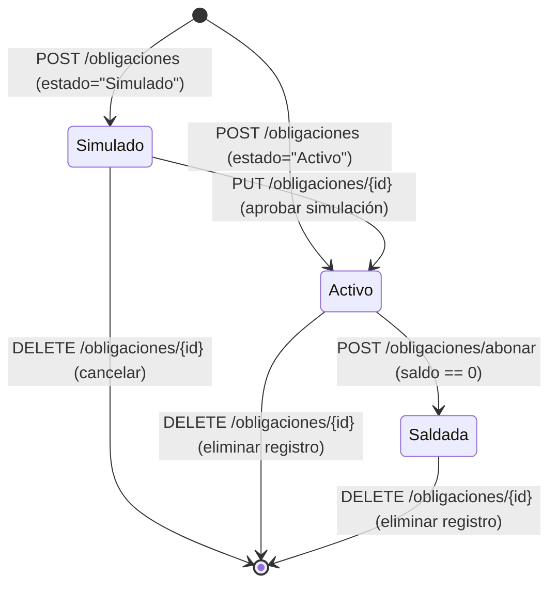

# Modelo de Datos y Esquemas (Data Model) — Integración GammaMobile v0.0.9

**Fecha:** 2026-10-20  
**Feature:** `integracion-gammamobile-v009`  
**Ubicación de código:** `src/api/schemas.py` y `src/logic/constants.py`

---

## 1. Esquemas de Datos (Pydantic / DTOs)

### 1.1 Módulo Asistencia

#### `AsistenciaMarcarRequest`
```python
class AsistenciaMarcarRequest(BaseModel):
    modo: str = "normal"  # "normal" | "directo"
```

#### `AsistenciaMarcarResponse`
```python
class AsistenciaMarcarResponse(BaseModel):
    tipo: str  # "entrada" | "salida" | "error"
    hora: str  # "HH:MM"
    mensaje: str  # Mensaje descriptivo retornado por AgenteAutonomoHoras
```

---

### 1.2 Módulo Finanzas y Movimientos

#### `MovimientoCreate` (Campos de entrada e inferencia)
```python
class MovimientoCreate(BaseModel):
    fecha: Optional[str] = None  # "DD/MM/YYYY" o "DD/MM" (default: hoy)
    movimiento: TipoMovimiento = TipoMovimiento.GASTO  # "Ingreso" | "Gasto"
    proveedor_cliente: str
    nro_factura: Optional[str] = "S/N"
    total: int = Field(..., gt=0)
    categoria: str = "Varios"
    comprobante: TipoComprobante = TipoComprobante.NO_LEGAL
    tasa_iva: TasaIVA = TasaIVA.IVA_10  # "10%" | "5%" | "Exento"
    id_obligacion: Optional[str] = None
    rastro_foto: Optional[str] = ""
    client_id: Optional[str] = None
```

#### Fórmulas de Desglose Tributario (Paraguay):
* Si `tasa_iva == "10%"`:
  $$\text{Gravada 10\%} = \text{round}\left(\frac{\text{Total}}{1.1}\right)$$
  $$\text{Monto IVA 10\%} = \text{Total} - \text{Gravada 10\%}$$
* Si `tasa_iva == "5%"`:
  $$\text{Gravada 5\%} = \text{round}\left(\frac{\text{Total}}{1.05}\right)$$
  $$\text{Monto IVA 5\%} = \text{Total} - \text{Gravada 5\%}$$
* Si `tasa_iva == "Exento"`:
  $$\text{Exenta} = \text{Total}$$
  $$\text{Monto IVA} = 0$$

---

### 1.3 Módulo Avisos y Eventos

#### `AvisoCreate`
```python
class AvisoCreate(BaseModel):
    titulo: str = Field(..., min_length=1)
    fecha_evento: str  # "DD/MM/YYYY HH:MM" o "DD/MM/YYYY"
    dias_restantes: Optional[int] = 0
    repeticion: str = "NINGUNA"  # "NINGUNA" | "DIARIA" | "SEMANAL" | "MENSUAL" | "ANUAL"
    hitos_minutos: list[int] = Field(default_factory=lambda: [1440])  # Hasta 5 hitos en minutos previos
```

#### `AvisoUpdate`
```python
class AvisoUpdate(BaseModel):
    titulo: Optional[str] = None
    fecha_evento: Optional[str] = None
    dias_restantes: Optional[int] = None
    repeticion: Optional[str] = None
    hitos_minutos: Optional[list[int]] = None
```

#### Estructura de Persistencia en `src/avisos.json`
```json
{
  "id": "a1b2c3d4",
  "event_id": "google_cal_id_xyz",
  "titulo": "Pago IPS",
  "fecha_evento": "25/10/2026 10:00",
  "dias_restantes": 5,
  "repeticion": "MENSUAL",
  "hitos_minutos": [1440, 180, 60],
  "alertas_disparadas": []
}
```

---

### 1.4 Módulo Deudas y Obligaciones

#### `ObligacionCreate`
```python
class ObligacionCreate(BaseModel):
    entidad: Optional[str] = "General"
    nombre: str = Field(..., min_length=1)
    tipo: str = "Deuda"  # "Deuda" | "Préstamo" | "Tarjeta" | "Gasto Fijo"
    monto_inicial: int = Field(..., gt=0)
    saldo_actual: Optional[int] = None  # Si es None, toma monto_inicial
    cuotas_totales: Optional[int] = 1
    cuotas_restantes: Optional[int] = 1
    cuota_referencia_gs: Optional[int] = 0
    dia_vencimiento: Optional[int] = 0
    fecha_inicio: Optional[str] = None  # Si es None, fecha actual DD/MM/YYYY
    estado: str = "Activo"  # "Activo" | "Simulado" | "Saldada"
    observaciones: Optional[str] = ""
```

#### `ObligacionUpdate`
```python
class ObligacionUpdate(BaseModel):
    entidad: Optional[str] = None
    nombre: Optional[str] = None
    tipo: Optional[str] = None
    monto_inicial: Optional[int] = None
    saldo_actual: Optional[int] = None
    cuotas_totales: Optional[int] = None
    cuotas_restantes: Optional[int] = None
    cuota_referencia_gs: Optional[int] = None
    dia_vencimiento: Optional[int] = None
    fecha_inicio: Optional[str] = None
    estado: Optional[str] = None  # Permite transición: "Simulado" -> "Activo"
    observaciones: Optional[str] = None
```

#### Transiciones de Estado en Obligaciones:


---

### 1.5 Módulo Logs del Sistema

#### `LogEntry`
```python
class LogEntry(BaseModel):
    timestamp: str  # "DD/MM/YYYY HH:MM:SS"
    nivel: str      # "INFO" | "WARN" | "ERROR"
    mensaje: str
```
