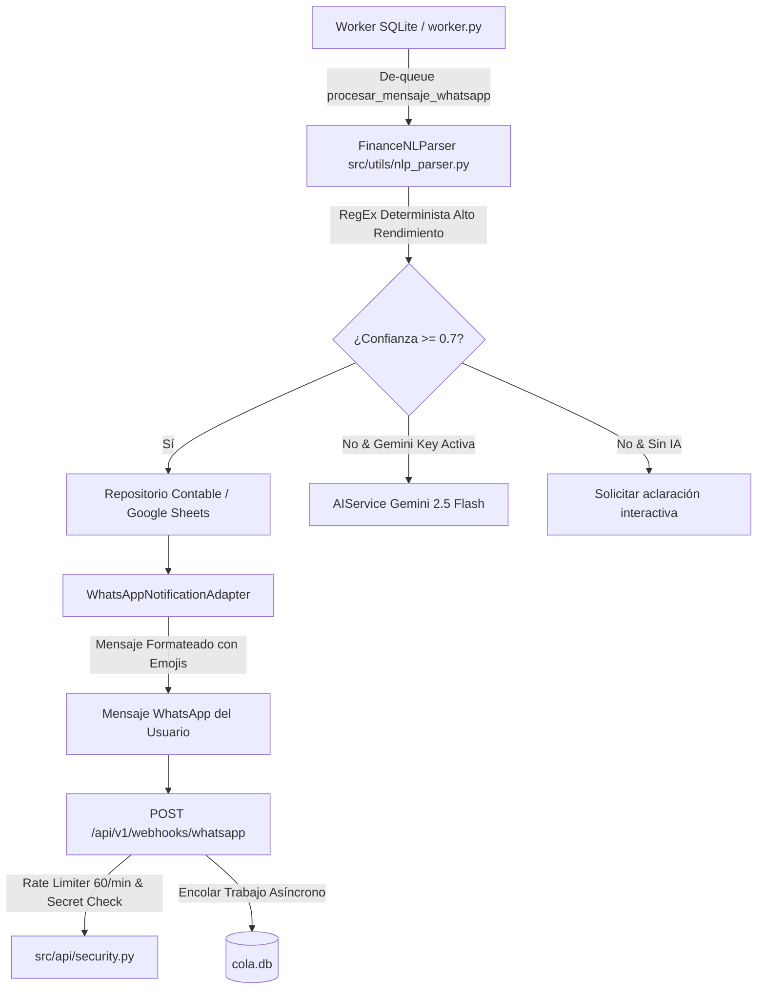

# Technical Plan & Architecture: Parser Conversacional de Lenguaje Natural, Rate-Limiting Webhooks y Extensiones UI para Gamma Mobile (v2.0.0 Fase 4)

---

## 1. Contratos de Datos y Esquemas Pydantic v2

### DTOs en `src/api/schemas.py`

```python
class ParseMovementRequest(BaseModel):
    texto: str = Field(..., min_length=2, max_length=500, description="Texto libre del movimiento financiero")

class ParsedMovement(BaseModel):
    valido: bool = Field(..., description="Indica si se extrajo un movimiento con confianza suficiente")
    tipo_movimiento: str = Field(default="Gasto", description="'Gasto' o 'Ingreso'")
    monto: float = Field(default=0.0, ge=0.0, description="Monto numérico total extraído")
    categoria: str = Field(default="Varios", description="Categoría normalizada")
    proveedor_cliente: str = Field(default="S/N", description="Comercio, cliente o proveedor detectado")
    descripcion: str = Field(default="", description="Descripción limpia del movimiento")
    confianza: float = Field(default=0.0, ge=0.0, le=1.0, description="Nivel de certeza de la extracción (0.0 a 1.0)")
```

---

## 2. Arquitectura Modular



### Componentes Principales:

1. **`FinanceNLParser` (`src/utils/nlp_parser.py`):**
   - **Reglas de detección de monto:**
     - Soporte para formatos paraguayos y globales: `45.000`, `45000`, `45k`, `45 mil`, `1.500.000`, `1.5M`.
     - Detección de divisas opcionales: `Gs`, `PYG`, `USD`, `$`, `Guaraníes`.
   - **Reglas de detección de tipo:**
     - Palabras clave de gasto: `gasto`, `gasté`, `compre`, `compré`, `pague`, `pagué`, `salida`, `compra`.
     - Palabras clave de ingreso: `ingreso`, `cobre`, `cobré`, `recibí`, `gané`, `cobro`, `entrada`, `sueldo`.
   - **Diccionario de categorías y comercios frecuentes:**
     - `Comida / Almuerzo / Cena / Restaurante / Bar / Cafe`: "Comida".
     - `Combustible / Petrobras / Shell / Copetrol / Nafta / Diesel`: "Combustible".
     - `Supermercado / Biggie / Superseis / Stock / Despensa`: "Supermercado".
     - `Farmacia / Medicamento / Punto Farma / Catedral`: "Salud".
     - `Pasaje / Uber / Bolt / Taxi / Colectivo`: "Transporte".
   - **Extracción de Comercio (`proveedor_cliente`):**
     - Reglas posicionales: texto posterior a `en`, `de`, `a` o coincidencia en diccionario de marcas conocidas.

2. **Hardening y Rate Limiting (`src/api/v1/routes_webhooks.py` y `src/api/security.py`):**
   - Limitar la ruta `POST /api/v1/webhooks/whatsapp` a `60 per minute` por dirección remota.
   - En caso de exceder, responder `HTTP 429` con estructura de error JSON estándar.
   - Validar límite máximo de tamaño de body (`max_content_length <= 64KB`).

3. **Integración en Worker (`src/app_queue/worker.py`):**
   - Manejo de `procesar_mensaje_whatsapp`:
     - Invoca `FinanceNLParser.parse(text)`.
     - Si es un movimiento válido (`valido=True` y `monto > 0`), se persiste contablemente usando la lógica de negocio existente y se responde con confirmación estructurada.
     - Si es un mensaje de ayuda (`"ayuda"`, `"menu"`, `"start"`), responde con guía rápida de comandos y sintaxis natural.

4. **Especificación UI para Gamma Mobile (Compose & Generative UI):**
   - Componente `WeatherForecastCard`: Tarjeta con visualización de estado climático, icono meteorológico, temperatura y viabilidad de trabajo exterior.
   - Componente `QuickAttendanceWidget`: Botón de acción flotante / tarjeta rápida con feedback háptico ydebounce contra doble toque.
   - Mockup Generative UI interactivo para verificación ergonómica y visual conforme a la regla global de verificación UI.

---

## 3. Manejo de Errores y Casos Borde

- **Monto cero o negativo:** Descartado con `valido=False`, no se inserta fila contable.
- **Texto con números no monetarios (ej. "el día 15 de marzo"):** El parser exige contexto monetario o proximidad a palabras de acción para no confundir fechas con montos.
- **Reintentos en la cola:** Si Google Sheets experimenta timeout temporal, `cola.db` reintenta con backoff exponencial sin duplicar el mensaje de confirmación al usuario.
