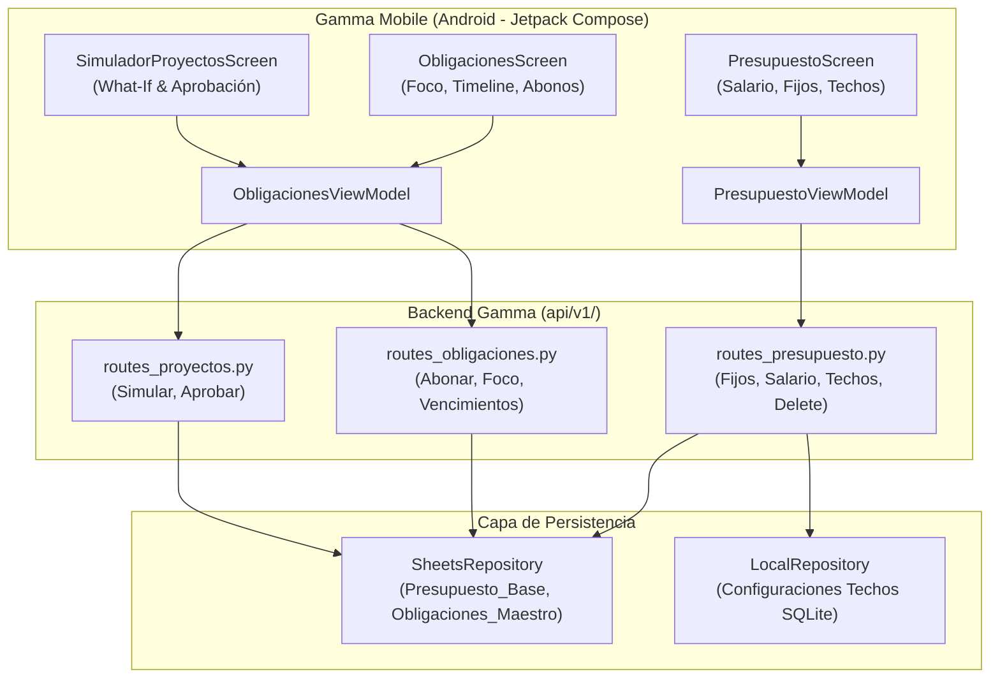

# Plan de Arquitectura y Contratos de Datos: Paridad Financiera, Acceso a Presupuesto y Saneamiento de Obligaciones

**Feature:** `paridad-presupuesto-obligaciones-mobile`  
**Fase SDD:** 0 — Especificación y Arquitectura  
**Fecha:** 2026-11-10  

---

## 1. Arquitectura Modular y Topología de Componentes



---

## 2. Contratos de Datos y Esquemas REST API

### 2.1 Presupuesto Base y Gastos Fijos

#### A. Nuevo Endpoint: Eliminar Gasto Fijo
- **Método / Ruta:** `DELETE /api/v1/presupuesto/fijos/<concepto>`
- **Headers:** `X-API-KEY: <token>`
- **Respuesta Exitosa (`HTTP 200 OK`):**
```json
{
  "status": "ok",
  "concepto": "Suscripción Innecesaria",
  "mensaje": "Gasto fijo eliminado correctamente de Presupuesto_Base."
}
```
- **Respuesta Error (`HTTP 404 Not Found`):**
```json
{
  "error": true,
  "code": "NOT_FOUND",
  "mensaje": "No se encontró el concepto fijo especificado.",
  "detalles": null
}
```

#### B. Nuevo Endpoint: Configurar Techo Presupuestario Variable
- **Método / Ruta:** `PUT /api/v1/presupuesto/techos/<categoria>`
- **Headers:** `X-API-KEY: <token>`
- **Payload (`JSON`):**
```json
{
  "limite_mensual": 1800000,
  "umbral_alerta": 80
}
```
- **Esquema Pydantic (`TechoPresupuestarioUpdate`):**
```python
class TechoPresupuestarioUpdate(BaseModel):
    limite_mensual: int = Field(gt=0, description="Monto límite mensual en Gs.")
    umbral_alerta: int = Field(default=80, ge=50, le=100, description="Porcentaje que dispara la advertencia.")
```
- **Respuesta Exitosa (`HTTP 200 OK`):**
```json
{
  "status": "ok",
  "categoria": "Supermercado",
  "limite_mensual": 1800000,
  "umbral_alerta": 80,
  "mensaje": "Techo presupuestario actualizado exitosamente."
}
```

---

### 2.2 Saneamiento de `Obligaciones_Maestro`: Dictamen de Columnas

Para mantener paridad sin rotura de esquemas, se definen tres niveles de soporte:

| Columna | Estado en Backend | Presencia en DTO Móvil | Tratamiento Operativo |
|---|---|---|---|
| `ID_Obligacion` | **Activo (Clave)** | Sí (`id`) | Identificador unívoco del crédito. |
| `Tipo` | **Activo** | Sí (`tipo`) | "Deuda", "Prestamo", "Tarjeta", "Credito". |
| `Nombre` | **Activo** | Sí (`nombre`) | Nombre descriptivo del compromiso. |
| `Entidad` | **Activo** | Sí (`entidad`) | Banco o institución acreedora. |
| `Monto_Inicial` | **Activo** | Sí (`monto_inicial`) | Capital contratado originalmente. |
| `Saldo_Actual` | **Activo** | Sí (`saldo_actual`) | Capital remanente (amortizado tras abonos). |
| `Estado` | **Activo** | Sí (`estado`) | "Activo", "Pausado", "Pagado", "Cancelado". |
| `Cuota_Referencia_Gs`| **Activo** | Sí (`cuota_referencia_gs`)| Cuota mensual a pagar en Gs. |
| `Fecha_Inicio` | **Activo** | Sí (`fecha_inicio`) | Fecha de inicio (`YYYY-MM-DD`). |
| `Observaciones` | **Activo** | Sí (`observaciones`) | Notas adicionales. |
| `Cuotas` | **OBSOLETO (Legacy)** | No (Omitido) | **Columna K:** Se preserva físicamente en Sheets para compatibilidad. En inserciones, el backend copia el valor de `Cuotas_Totales`. En lecturas, se ignora a favor de `Cuotas_Restantes`. |
| `Event_ID` | **OBSOLETO (Inactivo)** | No (Omitido) | **Columna L:** Se preserva físicamente en Sheets. El backend escribe `""` por defecto. En lecturas se ignora. |
| `Dia_Vencimiento` | **Activo** | Sí (`dia_vencimiento`) | Día del mes (1..31) en que vence la cuota. |
| `Cuotas_Totales` | **Activo** | Sí (`cuotas_totales`) | Total de cuotas acordadas. |
| `Cuotas_Restantes` | **Activo** | Sí (`cuotas_restantes`) | Cuotas pendientes a la fecha. |
| `Orden_Prioridad` | **Activo** | Sí (`orden_prioridad`) | Prioridad para estrategia Avalancha (1 = urgente). |
| `Es_Gasto_Fijo` | **Activo (v2.1)** | Sí (`es_gasto_fijo`) | 1 o 0 (si descuenta del Margen Libre Disponible). |

---

### 2.3 Contratos Kotlin para Gamma Mobile (Android Jetpack Compose)

```kotlin
// DTOs de Presupuesto
data class PresupuestoFijosResponse(
    @SerializedName("salario_base") val salarioBase: Long,
    @SerializedName("total_gastos_fijos") val totalGastosFijos: Long,
    val categorias: Map<String, List<GastoFijoItemDto>>
)

data class GastoFijoItemDto(
    val concepto: String,
    val monto: Long,
    @SerializedName("concepto_id") val conceptoId: String
)

data class TechoPresupuestarioItemDto(
    val categoria: String,
    @SerializedName("limite_mensual") val limiteMensual: Long,
    val consumido: Long,
    val porcentaje: Float,
    @SerializedName("umbral_alerta") val umbralAlerta: Int,
    @SerializedName("alerta_emitida") val alertaEmitida: Boolean,
    val estado: String, // "NORMAL" | "ALERTA" | "EXCEDIDO"
    val mensaje: String
)

data class TechoPresupuestarioUpdateRequest(
    @SerializedName("limite_mensual") val limiteMensual: Long,
    @SerializedName("umbral_alerta") val umbralAlerta: Int = 80
)

// DTOs de Abonos y Deuda Foco
data class AbonoObligacionRequest(
    val id: String,
    val monto: Long,
    val concepto: String = "Abono a obligación"
)

data class DeudaFocoResponse(
    val estrategia: String, // "avalancha" | "bola_de_nieve"
    @SerializedName("deuda_foco") val deudaFoco: ObligacionDto?,
    val justificacion: String
)
```

---

## 3. Manejo de Errores y Seguridad

- **Seguridad:** Todos los nuevos endpoints requieren `X-API-KEY` o `Authorization: Bearer`.
- **Validaciones:**
  - `limite_mensual` > 0.
  - `umbral_alerta` entre 50 y 100%.
  - `concepto` no puede ser vacío en `DELETE /presupuesto/fijos/<concepto>`.
- **Códigos de Estado HTTP:**
  - `200 OK`: Operación exitosa.
  - `201 Created`: Alta exitosa.
  - `400 Bad Request`: Error de validación en esquema Pydantic.
  - `401 Unauthorized`: API Key ausente o inválida.
  - `404 Not Found`: Gasto fijo o categoría no encontrada.
  - `500 Internal Server Error`: Falla de red con Google Sheets o SQLite.
