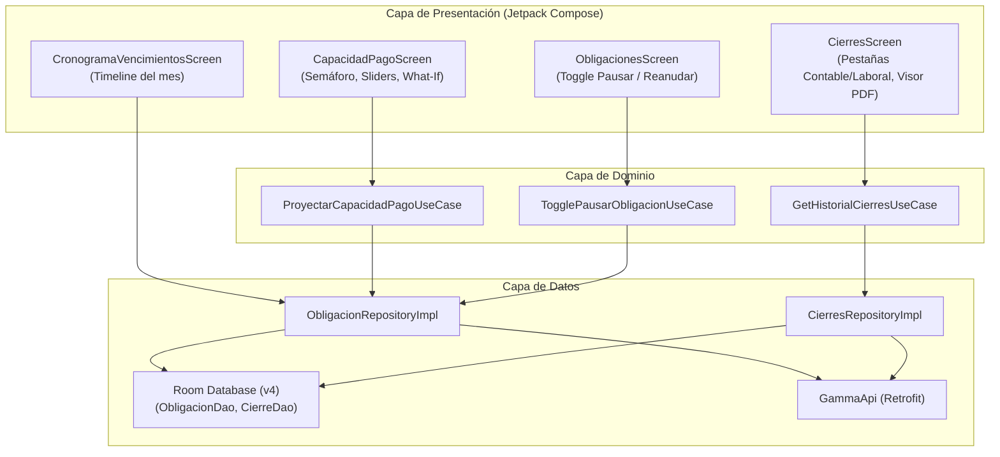

# Plan de Arquitectura y Diseño Técnico (Plan) — Versión v0.2.0
## Módulo: Proyector de Capacidad de Pago, Pausado de Deudas, Historial de Cierres y Timeline de Vencimientos

- **Fecha:** 20 de Octubre de 2026
- **Versión de Plan:** 2.0.0
- **Fase SDD:** 0 (Especificación y Arquitectura)

---

## 1. Arquitectura y Contratos de Datos



---

## 2. Contratos de API (DTOs y Modelos de Dominio)

### 2.1. Proyección de Capacidad de Pago
- **Endpoint:** `POST /api/v1/obligaciones/proyectar-capacidad`
- **Request Body (`CapacidadPagoRequest`):**
  ```kotlin
  data class CapacidadPagoRequest(
      @SerializedName("deudas_pausadas_simuladas")
      val deudasPausadasSimuladas: List<String> = emptyList(),
      @SerializedName("abonos_extraordinarios")
      val abonosExtraordinarios: Map<String, Long> = emptyMap(),
      @SerializedName("ajuste_ingreso_extra")
      val ajusteIngresoExtra: Long = 0L
  )
  ```
- **Response Body (`CapacidadPagoResponse`):**
  ```kotlin
  data class CapacidadPagoResponse(
      @SerializedName("compromiso_total_mes")
      val compromisoTotalMes: Long,
      @SerializedName("fondo_disponible_mes")
      val fondoDisponibleMes: Long,
      @SerializedName("capacidad_neta")
      val capacidadNeta: Long,
      @SerializedName("semaforo")
      val semaforo: String, // "SUPERAVIT", "AJUSTADO", "DEFICIT"
      @SerializedName("dti_proyectado")
      val dtiProyectado: Double,
      @SerializedName("meses_ahorrados_por_abonos")
      val mesesAhorradosPorAbonos: Map<String, Int> = emptyMap()
  )
  ```

### 2.2. Historial de Cierres
- **Endpoint:** `GET /api/v1/cierres`
- **Response Body (`List<CierreHistorialItem>`):**
  ```kotlin
  data class CierreHistorialItem(
      @SerializedName("id")
      val id: String,
      @SerializedName("tipo")
      val tipo: String, // "contable" o "laboral"
      @SerializedName("periodo")
      val periodo: String,
      @SerializedName("fecha")
      val fecha: String,
      @SerializedName("total_monto")
      val totalMonto: Long,
      @SerializedName("total_horas")
      val totalHoras: Double,
      @SerializedName("resumen")
      val resumen: String,
      @SerializedName("pdf_url")
      val pdfUrl: String?,
      @SerializedName("pdf_disponible")
      val pdfDisponible: Boolean
  )
  ```

---

## 3. Persistencia Local en Room (Bump a DB Version 4)

Se añadirá la entidad `CierreEntity` y su DAO para soportar consulta en modo offline:
```kotlin
@Entity(tableName = "cierres")
data class CierreEntity(
    @PrimaryKey val id: String,
    val tipo: String,
    val periodo: String,
    val fecha: String,
    val totalMonto: Long,
    val totalHoras: Double,
    val resumen: String,
    val pdfUrl: String?,
    val pdfDisponible: Boolean
)
```

---

## 4. Estados de la UI y Ergonomía

1. **Capacidad de Pago:**
   - La pantalla contará con un resumen superior con el semáforo Material 3 (`primaryContainer` para superávit, `tertiaryContainer` para ajustado, `errorContainer` para déficit).
   - Lista interactiva de deudas del mes con switch de inclusión/pausa rápida.
2. **Historial de Cierres:**
   - Tarjetas monolíticas con `contentPadding.bottom = 120.dp` para navegación fluida.
   - Botón directo para invocar `Intent.ACTION_VIEW` con el MIME type `application/pdf`.
