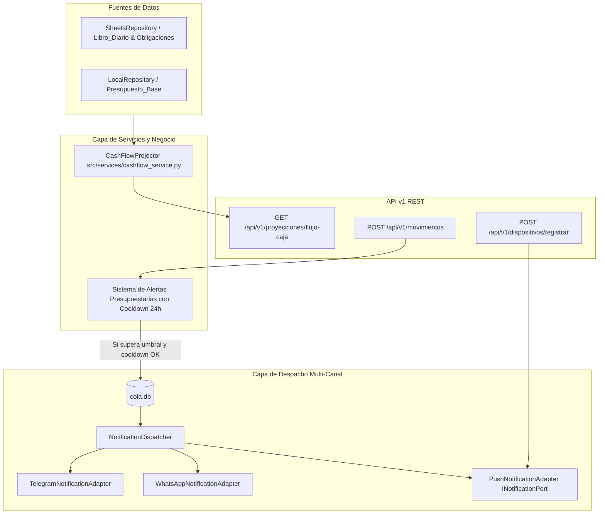

# Technical Plan & Architecture: Proyector de Flujo de Caja, Alertas Presupuestarias y Notificaciones Push (v2.0.0 Fase 5)

---

## 1. Contratos de Datos y Esquemas Pydantic v2

### En `src/api/schemas.py`:

```python
class FlujoCajaItemDiario(BaseModel):
    fecha: str = Field(..., description="Fecha del día proyectado (YYYY-MM-DD)")
    saldo_inicial: float = Field(..., description="Saldo al comenzar el día")
    ingresos: float = Field(default=0.0, description="Ingresos previstos en el día")
    egresos_fijos: float = Field(default=0.0, description="Gastos fijos / cuotas a vencer en el día")
    egresos_variables: float = Field(default=0.0, description="Estimación de gasto diario ordinario")
    saldo_final: float = Field(..., description="Saldo al finalizar el día")
    compromisos: list[str] = Field(default_factory=list, description="Nombres de obligaciones o servicios que vencen")


class FlujoCajaResponse(BaseModel):
    saldo_actual: float = Field(..., description="Saldo real actual al inicio del horizonte")
    saldo_proyectado_30d: float = Field(..., description="Saldo esperado al día 30")
    total_ingresos_proyectados: float = Field(..., description="Suma de ingresos esperados en 30 días")
    total_gastos_fijos: float = Field(..., description="Suma de cuotas y servicios fijos a vencer")
    total_gastos_variables_estimados: float = Field(..., description="Suma proyectada de gastos variables")
    dias_criticos: list[dict[str, Any]] = Field(
        default_factory=list,
        description="Días con saldo negativo o por debajo del umbral de reserva",
    )
    dias: list[FlujoCajaItemDiario] = Field(..., description="Serie temporal de 30 días")


class DispositivoCreate(BaseModel):
    model_config = ConfigDict(populate_by_name=True)

    device_token: str = Field(..., min_length=10, max_length=500, description="Token push único del dispositivo")
    platform: str = Field(default="android", pattern="^(android|ios|web)$", description="Plataforma del cliente")
    alias_usuario: Optional[str] = Field(default="default", max_length=100)


class DispositivoResponse(BaseModel):
    status: str = "ok"
    registrado: bool = True
    dispositivos_activos: int = 1
```

---

## 2. Arquitectura Modular



### Componentes Principales:

1. **`CashFlowProjector` (`src/services/cashflow_service.py`):**
   - Recibe la fecha de inicio (hoy) y saldo inicial.
   - Consulta las obligaciones activas no saldadas y sus días de vencimiento del mes.
   - Estima el gasto diario promedio variable con base en el consumo mensual histórico.
   - Aplica los ingresos calendarizados (sueldo usualmente a fin de mes o quincena).
   - Itera 30 días calculando `saldo_inicial + ingresos - egresos_fijos - egresos_variables = saldo_final`.
   - Identifica días con `saldo_final < 0` o por debajo de la reserva mínima de emergencia.

2. **Ruta REST `GET /api/v1/proyecciones/flujo-caja` (`src/api/v1/routes_proyecciones.py`):**
   - Montada en `v1_bp`, protegida por `X-API-KEY`.
   - Responde con el esquema `FlujoCajaResponse`.

3. **Módulo de Alertas Proactivas Presupuestarias:**
   - Ubicado en `src/services/presupuesto_service.py` o integrado con `evaluar_techo_presupuestario`.
   - Alerta con emojis estructurados cuando `porcentaje_consumido >= umbral`.
   - Control de cooldown en memoria: `(recipient_id, categoria) -> timestamp_ultima_alerta`. Si pasaron menos de 24 horas (86.400 segundos), se suprime para evitar spam.

4. **`PushNotificationAdapter` (`src/adapters/notifications/push_adapter.py`):**
   - Implementa `INotificationPort`.
   - Envío de notificaciones push (simulado en modo local/mock y listo para HTTP FCM).
   - Administra almacén local de tokens de dispositivos (`data/dispositivos_push.json`).
   - Registrado en `NotificationDispatcher` bajo el canal `"push"`.

---

## 3. Manejo de Errores y Casos Borde

- **Obligaciones sin fecha o con formato inválido:** Se imputan automáticamente al último día hábil del mes (día 28).
- **Saldo actual negativo de inicio:** El proyector marca el día 1 como día crítico y advierte sobre iliquidez inmediata.
- **Múltiples tokens push por usuario:** El adaptador almacena un conjunto (`set`) deduplicado por token.
