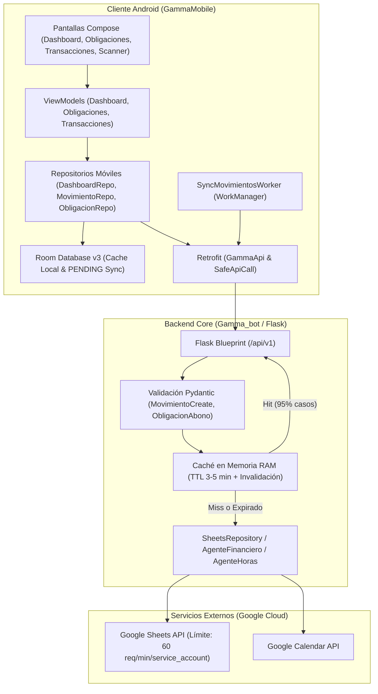

# Plan de Arquitectura Técnica y Contratos (Plan)
## Módulo: Remediación Integral UI/UX, Backend Contracts, Estabilización de Marcación y Blindaje de Cuotas Google Sheets (v0.1.0)

- **Fecha:** 20 de Octubre de 2026
- **Versión del Plan:** 1.0.0
- **Fase SDD:** 0 (Especificación y Arquitectura - Modo Planificador)
- **Estado:** En Revisión (Gate Obligatorio de Planificación)
- **Repositorios:** `GammaMobile` (`E:\PG\vcp-s\GammaMobile`) y `Gamma_bot` (`E:\PG\vcp-s\Gamma_bot`)

---

## 1. Arquitectura de Integración y Flujo de Datos



---

## 2. Contratos de Datos y Esquemas de Validación

### 2.1. Contrato `POST /api/v1/movimientos` (Registro y Sincronización)
Para resolver la falla de validación `ValidationError: proveedor_cliente field required`, se homologan los modelos:

- **Modelo Backend (Pydantic - `schemas.py`):**
  ```python
  class MovimientoCreate(BaseModel):
      fecha: Optional[str] = None
      movimiento: TipoMovimiento = TipoMovimiento.GASTO
      proveedor_cliente: str = Field(..., min_length=1)  # Obligatorio en backend
      nro_factura: Optional[str] = "S/N"
      total: int = Field(..., gt=0)
      categoria: str = "Varios"
      comprobante: TipoComprobante = TipoComprobante.NO_LEGAL
      tasa_iva: TasaIVA = TasaIVA.IVA_10
      id_obligacion: Optional[str] = None
      rastro_foto: Optional[str] = ""
      client_id: Optional[str] = None
  ```

- **Modelo Móvil Actualizado (`Models.kt` y `MovimientoEntity.kt`):**
  ```kotlin
  data class Movimiento(
      @SerializedName("id") val id: String = "",
      @SerializedName("fecha") val fecha: String = "",
      @SerializedName(value = "tipo", alternate = ["movimiento"]) val tipo: String = "gasto",
      @SerializedName("proveedor_cliente") val proveedorCliente: String = "Varios",
      @SerializedName("nro_factura") val nroFactura: String = "S/N",
      @SerializedName("categoria") val categoria: String = "Varios",
      @SerializedName("total") val total: Long = 0L,
      @SerializedName("comprobante") val comprobante: String = "No Legal",
      @SerializedName("tasa_iva") val tasaIva: String = "10%",
      @SerializedName("client_id") val clientId: String = id
  )
  ```
- **Corrección de Mojibake:**  
  En `NuevaTransaccionScreen.kt`:
  * `"Física Legal"` $\rightarrow$ `"Física Legal"`
  * `"₲"` $\rightarrow$ `"₲"`
  * `"Compré"` $\rightarrow$ `"Compré"`
  * `"Transacción"` $\rightarrow$ `"Transacción"`

### 2.2. Contrato `GET /api/v1/obligaciones` (Preservación de Deudas)
- **Cabeceras en Google Sheets (`constants.py`):**  
  `ENCABEZADOS_OBLIGACIONES_MAESTRO` debe incorporar `"Entidad"`:
  ```python
  ENCABEZADOS_OBLIGACIONES_MAESTRO = [
      "ID", "Nombre", "Tipo", "Entidad", "Monto_Inicial", "Saldo_Actual",
      "Estado", "Dia_Vencimiento", "Cuotas_Totales", "Cuotas_Restantes",
      "Cuota_Referencia_Gs", "Fecha_Inicio", "Observaciones"
  ]
  ```
- **Serialización en `blueprint.py` (`get_obligaciones`):**
  Devolver el diccionario con todos los campos sin filtrado restrictivo:
  ```python
  {
      "id": d.get("ID", ""),
      "nombre": d.get("Nombre", ""),
      "tipo": d.get("Tipo", ""),
      "entidad": d.get("Entidad", ""),
      "monto_inicial": safe_int(d.get("Monto_Inicial", 0)),
      "saldo_actual": safe_int(d.get("Saldo_Actual", 0)),
      "estado": d.get("Estado", "Activa"),
      "dia_vencimiento": safe_int(d.get("Dia_Vencimiento", 0)),
      "cuotas_totales": safe_int(d.get("Cuotas_Totales", 0)),
      "cuotas_restantes": safe_int(d.get("Cuotas_Restantes", 0)),
      "cuota_referencia_gs": safe_int(d.get("Cuota_Referencia_Gs", 0)),
      "fecha_inicio": d.get("Fecha_Inicio", ""),
      "observaciones": d.get("Observaciones", "")
  }
  ```
- **Estrategia en Android (`ObligacionRepositoryImpl.kt`):**
  Reemplazar `obligacionDao.deleteAll()` por un *upsert* inteligente:
  `obligacionDao.insertAll(nuevas)` usando `@Insert(onConflict = OnConflictStrategy.REPLACE)`.

### 2.3. Contrato `POST /api/v1/obligaciones/abonar` (Paridad Contable)
- **Endpoint:** `POST /api/v1/obligaciones/abonar`
- **Request Payload:**
  ```json
  {
      "id_obligacion": "OBL-12345",
      "monto": 250000,
      "categoria": "Préstamos / Deudas",
      "comprobante": "No Legal"
  }
  ```
- **Lógica en Backend (`blueprint.py`):**
  1. Validar que la obligación exista y esté activa.
  2. Ejecutar amortización en `Obligaciones_Maestro`: `repo.update_obligacion_saldo(id, nuevo_saldo)`.
  3. **Generar el egreso contable en `Libro_Diario`:**
     ```python
     repo.insert_movimiento_diario({
         "fecha": get_now_py().strftime("%d/%m/%Y"),
         "movimiento": "Gasto",
         "proveedor_cliente": obligacion.get("Entidad") or obligacion.get("Nombre"),
         "nro_factura": "S/N",
         "total": monto,
         "categoria": "Préstamos / Deudas",
         "comprobante": comprobante,
         "tasa_iva": "Exenta",
         "id_obligacion": id_obligacion
     })
     ```
  4. Invalidar la caché en memoria del balance y libro diario.

---

## 3. Arquitectura de Blindaje de Cuotas de Google Sheets API

### 3.1. En Android (`GammaMobile`): Eliminación del Cache-Bypass en Navegación
En [DashboardViewModel.kt](file:///E:/PG/vcp-s/GammaMobile/app/src/main/java/com/gamma/mobile/presentation/dashboard/DashboardViewModel.kt#L101-L104):
```kotlin
fun onScreenVisible() {
    if (!initialLoadDone) return
    // Respetar la caché local de 15 min; calcular reactivamente los movimientos pendientes locales
    loadDashboard(forceRefresh = false, silent = true)
}
```
- `DashboardSummaryCalculator` ya suma instantáneamente los movimientos en estado `PENDING` al saldo en memoria.
- `forceRefresh = true` solo se ejecuta ante eventos explícitos:
  * Pull-to-refresh del usuario.
  * Inmediatamente después de guardar una nueva transacción en `NuevaTransaccionScreen`.
  * Tras abonar o registrar una obligación.

### 3.2. En Backend (`Gamma_bot`): Caché en Memoria RAM con Invalidation Hook
Se implementa una estructura de caché en memoria de proceso en `repositories/sheets_repository.py`:
```python
class InMemorySheetsCache:
    def __init__(self, default_ttl_seconds=180): # 3 minutos
        self._cache = {}
        self._ttl = default_ttl_seconds

    def get(self, key: str):
        if key in self._cache:
            entry, expire_at = self._cache[key]
            if time.time() < expire_at:
                return entry
            del self._cache[key]
        return None

    def set(self, key: str, value: Any, custom_ttl: Optional[int] = None):
        ttl = custom_ttl or self._ttl
        self._cache[key] = (value, time.time() + ttl)

    def invalidate(self, key_prefix: str):
        keys_to_del = [k for k in self._cache if k.startswith(key_prefix)]
        for k in keys_to_del:
            del self._cache[k]

    def clear(self):
        self._cache.clear()
```
- **Puntos de Aplicación de Caché:**
  * `obtener_balance()`: Clave `balance_{mes}_{año}` (TTL: 180s).
  * `obtener_presupuesto_base_completo()`: Clave `presupuesto_base` (TTL: 300s).
  * `get_todas_obligaciones()`: Clave `obligaciones_todas` (TTL: 180s).
  * `get_all_movimientos()`: Clave `movimientos_todos` (TTL: 180s).
- **Puntos de Invalidación:**
  * `insert_movimiento_diario()` $\rightarrow$ Invalida `balance_` y `movimientos_`.
  * `insert_obligacion()`, `update_obligacion_saldo()` $\rightarrow$ Invalida `obligaciones_` y `presupuesto_base`.

---

## 4. Estabilización de la Marcación ("Marcar")

### 4.1. Auto-detección Dinámica de Período en `AgenteAutonomoHoras`
En [logic.py](file:///E:/PG/vcp-s/Gamma_bot/src/logic/logic.py#L238-L259):
- Si `periodo_actual.txt` no existe o está desactualizado, el sistema calcula el nombre oficial con el reloj del sistema en zona horaria Paraguay:
  ```python
  meses = ["Enero", "Febrero", "Marzo", "Abril", "Mayo", "Junio",
           "Julio", "Agosto", "Setiembre", "Octubre", "Noviembre", "Diciembre"]
  ahora = get_now_py()
  nombre_hoja_actual = f"{meses[ahora.month - 1]} {ahora.year}" # Ej: "Octubre 2026"
  ```
- Se elimina el fallback hardcodeado a `"Mayo 2026"`.

### 4.2. Agrupación y Optimización de Consultas a Google Sheets
- `_obtener_o_crear_fila_hoy()` y `ejecutar_marcado_para_bot()` deben leer en un único viaje de red la columna de fechas y la fila actual mediante un `batch_get`, en lugar de 4 llamadas individuales (`worksheet()`, `col_values`, `row_values`, `update`).

### 4.3. Tratamiento de Rate Limits (HTTP 429)
Si Google Sheets responde `APIError 429`:
- El backend debe capturar específicamente `gspread.exceptions.APIError` con código 429 y devolver:
  ```json
  {
      "error": {
          "code": "RATE_LIMIT_EXCEEDED",
          "message": "Servicio de Google Sheets saturado temporalmente. Espera 60 segundos antes de reintentar."
      }
  }
  ```
  con código de estado `HTTP 429 Too Many Requests`.

---

## 5. Arquitectura de UI / UX y Correcciones Ergonómicas

### 5.1. Anti-Solapamiento Táctil en Listas con FABs
- **`ObligacionesScreen.kt`:**
  * 2 Extended FABs ($56\text{dp} \times 2 + 8\text{dp} + 16\text{dp} = 136\text{dp}$).
  * `contentPadding = PaddingValues(start = 16.dp, end = 16.dp, top = 8.dp, bottom = 152.dp)`.
  * Garantiza $16\text{dp}$ de margen táctil de seguridad entre el último botón de la última tarjeta ("Cancelar" / "Abonar") y el FAB superior.
- **`AvisosScreen.kt`:**
  * Extended FAB + Small FAB ($120\text{dp}$).
  * `contentPadding.bottom = 136.dp`.
- **`DashboardScreen.kt`:**
  * Remover la línea `Spacer(modifier = Modifier.height(96.dp))` innecesaria en la raíz de la lambda del Scaffold.

### 5.2. Corrección del Renderizado del Scanner SIFEN (`SifenScannerScreen.kt`)
En [SifenScannerScreen.kt](file:///E:/PG/vcp-s/GammaMobile/app/src/main/java/com/gamma/mobile/presentation/sifen/SifenScannerScreen.kt#L286-L308):
```kotlin
Canvas(
    modifier = Modifier
        .fillMaxSize()
        .graphicsLayer {
            compositingStrategy = CompositingStrategy.Offscreen
        }
) {
    drawRect(color = Color.Black.copy(alpha = 0.6f))
    drawRoundRect(
        color = Color.Transparent,
        topLeft = Offset(left, top),
        size = Size(boxSize, boxSize),
        cornerRadius = CornerRadius(16.dp.toPx(), 16.dp.toPx()),
        blendMode = BlendMode.Clear
    )
}
```
- La estrategia `CompositingStrategy.Offscreen` fuerza el renderizado en un buffer auxiliar de texturas, permitiendo que `BlendMode.Clear` recorte el visor transparentemente sobre la imagen de la cámara sin pintar artefactos negros opacos.

### 5.3. Sincronización Estética de Barra de Estado (`Theme.kt`)
- Establecer `window.statusBarColor = colorScheme.background.toArgb()`.
- Garantiza transición imperceptible y fluida entre la barra de estado y los `TopAppBar`.

---

## 6. Persistencia Offline en Room v3

### 6.1. DAO de Avisos (`AvisoDao.kt`)
Incorporar:
```kotlin
@Insert(onConflict = OnConflictStrategy.REPLACE)
suspend fun insert(aviso: AvisoEntity)

@Query("DELETE FROM avisos WHERE id = :id")
suspend fun deleteById(id: String)
```
Y conectar `AvisoRepositoryImpl.kt` para que `createAviso` y `deleteAviso` reflejen los cambios inmediatamente en la base de datos local Room.
