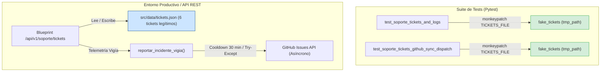

# Plan de Arquitectura y Diseño Técnico (Plan) — Saneamiento de Tickets, Blindaje de Telemetría Vigía y Aislamiento de CI

- **Fecha:** 26 de Octubre de 2026
- **Módulo:** Soporte, Telemetría y Suite de Pruebas de API Móvil (`Gamma_bot`)
- **Fase SDD:** 0 (Especificación y Arquitectura)
- **Estado:** Listo para revisión de planificación (Planning Gate)

---

## 1. Arquitectura Modular y Flujo de Datos



---

## 2. Contratos de Datos y Esquemas

### 2.1 Esquema Canónico de Ticket en `src/data/tickets.json`
```json
{
  "$schema": "http://json-schema.org/draft-07/schema#",
  "type": "array",
  "items": {
    "type": "object",
    "required": ["id", "asunto", "descripcion", "estado", "fecha", "origen", "resolucion"],
    "properties": {
      "id": {
        "type": "string",
        "pattern": "^TCK-[0-9]{3,}$"
      },
      "asunto": { "type": "string" },
      "descripcion": { "type": "string" },
      "estado": {
        "type": "string",
        "enum": ["Abierto", "En Progreso", "Cerrado", "Rechazado"]
      },
      "fecha": {
        "type": "string",
        "pattern": "^[0-9]{2}/[0-9]{2}/[0-9]{4}$"
      },
      "origen": {
        "type": "string",
        "enum": ["app", "telegram", "ci", "servidor"]
      },
      "resolucion": { "type": "string" }
    }
  }
}
```

### 2.2 Lista de Tickets Legítimos a Preservar
| ID | Asunto | Origen | Estado | Fecha |
|---|---|---|---|---|
| `TCK-001` | Configuración de Conexión y API Key en Android | `app` | `Cerrado` | 14/10/2026 |
| `TCK-002` | Desalineación de esquemas en Libro Diario y Obligaciones | `app` | `Cerrado` | 14/10/2026 |
| `TCK-003` | Sincronización salarial Libro Diario hacia Presupuesto Base | `telegram` | `Cerrado` | 15/10/2026 |
| `TCK-004` | Errores en el cierre mensual y la marcación de materias | `app` | `Cerrado` | 16/10/2026 |
| `TCK-005` | Fallo en cierre mensual de ingresos y egresos contables | `ci` | `Cerrado` | 15/10/2026 |
| `TCK-006` | Despliegue y recarga de worker en PythonAnywhere | `servidor` | `Cerrado` | 15/10/2026 |

---

## 3. Patrón de Aislamiento para la Suite de Pruebas

### 3.1 Defecto Actual en `tests/test_mobile_api.py`
En `test_soporte_tickets_github_sync_dispatch`:
```python
# ❌ VULNERABLE A FUGAS DE ESTADO:
def test_soporte_tickets_github_sync_dispatch(client):
    headers = {"X-API-KEY": "test-secret-key"}
    # Directamente client.post() muta src/data/tickets.json en disco
```

### 3.2 Solución Arquitectónica
Inyección de fixtures canónicos de pytest (`tmp_path` y `monkeypatch`):
```python
# ✅ AISLADO HERMÉTICAMENTE:
def test_soporte_tickets_github_sync_dispatch(client, monkeypatch, tmp_path):
    headers = {"X-API-KEY": "test-secret-key"}
    fake_tickets = tmp_path / "tickets.json"
    fake_tickets.write_text("[]", encoding="utf-8")
    monkeypatch.setattr("api.blueprint.TICKETS_FILE", fake_tickets)
    # Toda mutación se produce en el directorio efímero de tmp_path
```

---

## 4. Auditoría y Resiliencia de Telemetría Vigía

1. **Cooldown Anti-Spam:**
   - La telemetría en `src/com/core/telemetry.py` calcula el hash SHA-256 de la firma del error (`error_signature`).
   - Mantiene una ventana de 30 minutos (`COOLDOWN_SECONDS = 1800`) antes de permitir re-despacho del mismo error a GitHub.
2. **Degradación Elegante:**
   - Si la llamada HTTP a GitHub falla por timeout, credenciales ausentes o error de red, la función atrapa la excepción genérica `Exception`, registra el warning en log interno y retorna `False`.
   - Se debe verificar que esta degradación no interrumpa el endpoint HTTP ni genere `500 Internal Server Error`.

---

## 5. Manejo de Errores y Estrategia de Rollback

- Ante cualquier falla en el archivo de tickets (`JSONDecodeError`), el backend debe mantener su fallback existente retornando lista vacía o manejando el error limpiamente.
- Las pruebas automatizadas deben verificar que el archivo productivo `src/data/tickets.json` no sufra modificaciones antes ni después de correr la suite completa (`git status` inalterado).
